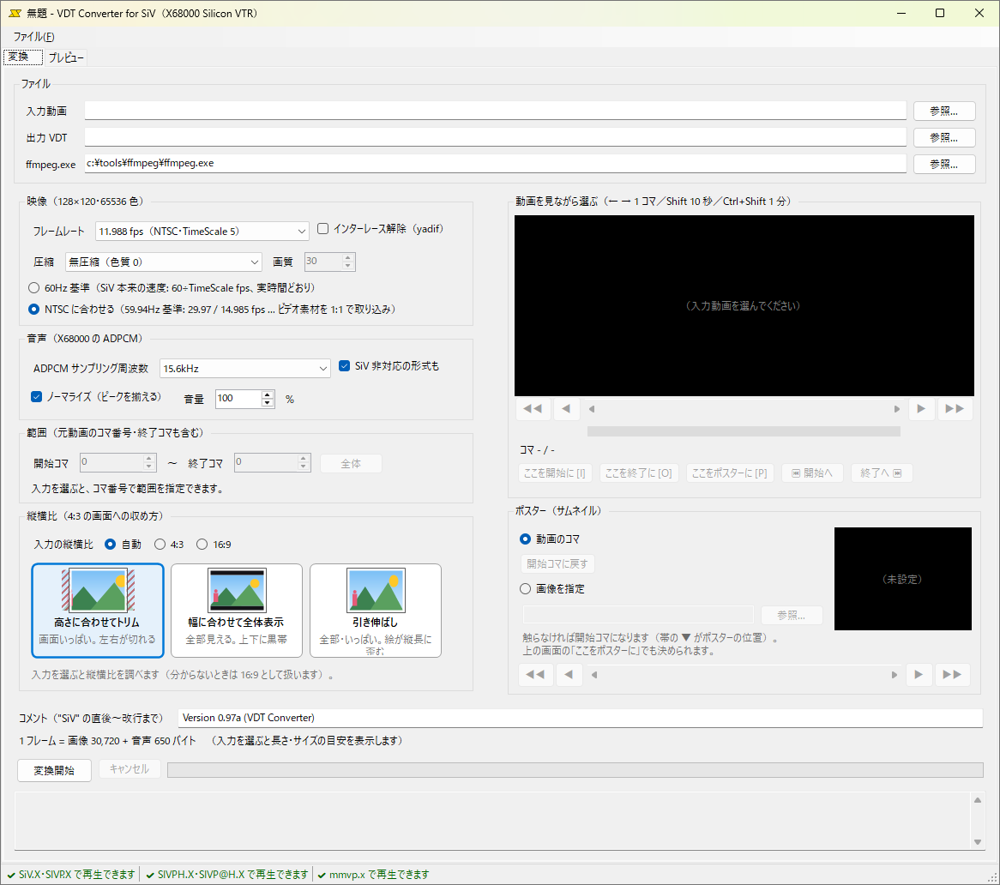

# SiV — X68000 の動画ソフトと VDT コンバーター

1989〜1993 年ごろに X68000 用に作った動画取り込み・再生ソフト **SiV（Silicon VTR）** と、
いまの動画を SiV の動画ファイル（.VDT）に変換する Windows 用ツールをまとめたリポジトリです。



| フォルダ | 中身 |
|---|---|
| `VdtConverter/` | 動画 → VDT 変換ツール（C# / .NET 8 の Windows フォームアプリ）。使い方は [VdtConverter/README.md](VdtConverter/README.md)、VDT の形式は [VDT_FORMAT_NOTES.md](VdtConverter/VDT_FORMAT_NOTES.md) |
| `x68k/` | X68000 側の実行ファイルと説明書（SiVPack） |

## ダウンロード

ビルド済みの zip は [Releases](../../releases) にあります。中身は次のとおりです。

- `VdtConverter/VdtConverter.exe`（動かすには [.NET 8 デスクトップ ランタイム](https://dotnet.microsoft.com/download/dotnet/8.0) と `ffmpeg.exe` が要ります）
- `x68k/`（このリポジトリの x68k フォルダと同じもの）

新しい版を出すときは、タグを付けて push するだけで GitHub Actions が zip を作って Releases に載せます。

```
git tag v0.1.0
git push origin v0.1.0
```

## x68k/ の中身

| ファイル | 説明 |
|---|---|
| `SIV.X` | 動画の取り込み・再生（0.97a） |
| `SIV097B.BFD` | 0.97a → 0.97b の差分パッチ |
| `SIV097C.X` | 未公開版 0.97c |
| `SIVP.X` | 再生専用プレイヤー（0.60b）。マルチ再生・拡大縮小など |
| `SIVP@.X` | 未公開版 0.60?。拡大縮小回転半透明表示（-D8）付き |
| `SIVPH.X` | `SIVP.X` に HDD 読み出し再生を足した改造版（0.60H） |
| `SIVP@H.X` | `SIVP@.X` に HDD 読み出し再生を足した改造版（0.6@H）。拡大縮小（-D7）の幅 251 / 252 で画面が乱れるバグも修正 |
| `VDT2CGA.X` | VDT → CGA 変換ツール |
| `*.DOC` / `*.TXT` | 説明書・VDT と CGA の仕様書 |
| `SIV.ICN` / `SIV.BCK` | SiV のアイコンと壁紙 |

`SIVPH.X` / `SIVP@H.X` は、メモリに入りきらない VDT を自動で HDD から読みながら再生します（入るものは元と同じ動き）。
起動時の版表示が `0.60H` / `0.6@H` なら改造版です。

## クレジット

- SiV / SiVP：pOno（小野 達哉）
- SiVP の拡大縮小回転半透明転送ルーチン、NewCRT.S：B6hukube 氏
- 改造版（HDD 再生）と VdtConverter は Claude と一緒に作成

SiV の VDT 形式は、nenetto 氏の mmvp.x（vdt / v16 / vtr プレーヤ）でも再生できます（無圧縮のみ）。
