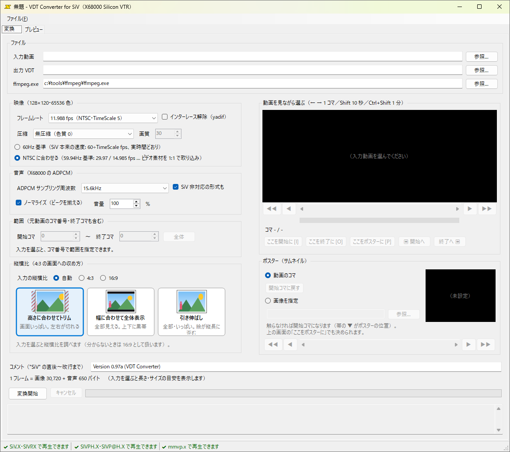

# VDT Converter for SiV
Windowsで扱える動画ファイルを、X68000用動画ソフト SiV（Silicon VTR）0.97 のデータファイル.VDTに変換するWindowsフォームアプリ（C# / .NET 8）。
変換結果をその場で確認できる簡易プレーヤー付き。



## 必要なもの
- Windows 10 / 11
- .NET 8 SDK（ビルド用）、または Visual Studio 2022
- ffmpeg.exe（動画のデコードに使う）
  - アプリ（VdtConverter.exe）と同じフォルダに置くか、PATH に入れておけば自動で見つかります
  - 画面の「ffmpeg.exe」欄で場所を直接指定することもできます

## ビルド
```
cd VdtConverter
dotnet build -c Release
```

出来上がりは `bin\Release\net8.0-windows\VdtConverter.exe`。
Visual Studio なら `VdtConverter.csproj` を開いて F5 で動きます。

1個のexeにまとめたいとき:

```
dotnet publish -c Release -r win-x64 --self-contained false -p:PublishSingleFile=true
```

## 使い方

1. 「入力動画」で動画を選ぶ（ウインドウへのドラッグ＆ドロップでも OK）
2. 映像・音声・範囲・ポスターを設定する
3. 「変換開始」を押す。終わると「プレビュー」タブに結果が読み込まれる

### 映像

フレームレートは以下から選択
　30 / 20 / 15 / 12 / 10 / 6 / 5 / 4 / 3 / 2 / 1 fps（ヘッダの TimeScale = 60÷fps）

　30fpsそのまま：60Hz基準。VDT のフレームnは、入力の n×TimeScale/60秒の絵。実時間どおりで、29.97fpsの素材だと約1000フレームに1回コマが重なる
　NTSC に合わせる：59.94Hz 基準。一覧の表示も 29.97 / 19.98 / 14.985…fpsに切り替わる。フレームnは、入力のn×TimeScale×1001/60000秒の絵。29.97fpsの素材をコマの重複も欠けもなく 1:1 で取り込み、音声もその長さに合わせて詰める。再生は0.1%速くなるが、絵と音はずれない
　インターレース解除：ビデオ取り込み素材向け（yadif）

### 縦横比（4:3 の画面への収め方）

X68000では128×120が4:3の画面いっぱいに出るので、画素の縦横比1.25:1を考慮して縮める。

- 入力の縦横比：「自動」は ffmpeg が報告する表示縦横比（SAR・回転メタデータも考慮）を使う。検出結果はラジオボタンの横に「自動（16:9・1920×1080）」のように出る。DVD などで横長フラグの付いていないスクイーズ素材は、「16:9」を選べば正しく戻る
- 4:3 の素材：トリムも黒帯もなしで、そのまま画面いっぱいに使う（収め方のボタンは無効になる）
- それ以外の素材：図つきのボタンで選ぶ。選ぶとポスターのプレビューにすぐ反映される

| ボタン | 動き |
|---|---|
| 高さに合わせてトリム | 画面いっぱい。はみ出した左右（縦長素材なら上下）を切る |
| 幅に合わせて全体表示 | 全部見える。上下（縦長素材なら左右）に黒帯 |
| 引き伸ばし | 全部を画面いっぱいに押し込む。絵が歪む |

### 音声（ADPCM）

| 選択肢 | ヘッダ値 | 1 秒のバイト数 | SiV 0.97 |
|---|---|---|---|
| 無音 | 0 | 0 | ○ |
| 7.8kHz | 2 | 3900 | ○ |
| 15.6kHz | 4 | 7800 | ○ |
| 5.2kHz | 1 | 2600 | ×（拡張。チェックを入れたときだけ選べる） |
| 10.4kHz | 3 | 5200 | ×（拡張。チェックを入れたときだけ選べる） |

- X68000 の MSM6258 で使える周波数は 3.9 / 5.2 / 7.8 / 10.4 / 15.6kHz の 5 つ。ただし SiV ではコード 0 を「無音」に使っているので、**3.9kHz は VDT では表せない**
- エンコードは OKI 4bit ADPCM（12bit 精度、ステップ表 49 段）。1 バイトに 2 サンプル入り、**下位ニブルが先**に再生される
- ノーマライズ、音量（10〜400%）を指定できる

### 動画を見ながら選ぶ（右側の画面）

スクロールバーで元動画のコマを 1 枚ずつ見られる。表示は X68000 での見え方（128×120、縦横比の収め方も反映）。

- スクロールバーで大まかな位置（バーの空いた所をクリックすると 10 秒）
- ◀ ▶ ボタン / ← → キーで 1 コマ
- ◀◀ ▶▶ ボタン / Shift+← → で 10 秒
- Ctrl+Shift+← → で 1 分
- 表示用のコマは、足りないときに ffmpeg を 1 回だけ起動して前後 120 コマ（約 4 秒）をまとめて読み、覚えておく（最大 3000 コマ ≒ 90MB）。コマ送りは 2 回目以降ほぼ一瞬。先の方も裏で読んでおく。収め方・縦横比・インターレース解除を変えると読み直す
- 下の帯：青が取り込む範囲、▼（オレンジ）がポスター、赤線がいま見ているコマ。帯をクリック／ドラッグしても移動できる
- 「ここを開始に [I]」「ここを終了に [O]」「ここをポスターに [P]」、「開始へ」「終了へ」（Home / End）

### 範囲（元動画のコマで指定）

開始コマと終了コマを、元動画のコマ番号（0 から、終了コマも含む）で指定する。変身集から 1 シーンだけ切り出すような使い方向け。
コマ番号は元動画のフレームレート（29.97fps なら 30000/1001 として正確に計算）で数える。
SiV は全フレームをメモリ上に展開するので、画面下の「X68000 側の展開メモリ」を目安に長さを決める。
30fps・15.6kHz だと 1 秒あたり約 0.92MB 使うので、12MB 機でも 12 秒前後が上限。
ただし SIVPH.X・SIVP@H.X は HDD から読みながら再生するので、メモリに入りきらない長さでも最後まで再生できる。

### ポスター

- 「動画のコマ」……ポスター欄のスクロールバーで選ぶ（操作は上の画面と同じ：◀ ▶ 1 コマ、◀◀ ▶▶ 10 秒）。帯の ▼ がその位置。触らなければ開始コマ。「開始コマに戻す」で元に戻る
- キーボードの ← → などは、キャレットがあるスクロールバー（青い枠）だけを動かす。どちらにもキャレットが無いときは何もしない（グループの中＝画像・帯・ボタン・空いた所をクリックするか、Tab で移すとそちらに移る。キー操作中のグループは名前の頭に「▶ キー操作中」と出る）
- 上のスクロールバー：← → 1 コマ、Shift 10 秒、Ctrl+Shift 1 分、Home/End で範囲の開始/終了、I/O/P で開始/終了/ポスター
- ポスターのスクロールバー：← → 1 コマ、Shift 10 秒、Ctrl+Shift 1 分、Home/End で動画の先頭/最後
- 「画像を指定」……PNG / JPEG / BMP などを 128×120 に縮めて使う（収め方は映像と同じボタンの設定。縦横比は画像自身のものを使う）
- ポスター用の音声は無音（1 フレーム分）

### プレビュー

VDT を開いて、ポスター表示・再生・コマ送り（スライダー）・リピートができる。
音声は ADPCM をデコードして鳴らす。圧縮（色質 1〜3）のファイルも画像を展開して表示する。

## プロジェクト（ファイル メニュー）

設定をまるごと `*.vdtproj` に保存して、あとで同じ状態に戻せる。

| メニュー | キー |
|---|---|
| 新しいプロジェクト | Ctrl+N |
| プロジェクトを開く | Ctrl+O（ウインドウへのドロップ、`VdtConverter.exe 〜.vdtproj` でも開く） |
| 上書き保存 | Ctrl+S |
| 名前を付けて保存 | Ctrl+Shift+S |
| 最近使ったプロジェクト | 10 件まで |

保存するもの: 入力動画・出力 VDT、フレームレート・NTSC・インターレース解除、圧縮（色質・画質）、縦横比と収め方、
ADPCM の周波数・ノーマライズ・音量、範囲（開始コマ・終了コマ）、見ていたコマ、ポスター（コマ番号／画像ファイル、開始コマについていくか）、コメント。
ffmpeg.exe の場所はパソコンごとの設定なので、プロジェクトには入れない。

- パスは絶対パスとプロジェクトからの相対パスの両方を持つ。動画とプロジェクトを同じフォルダごと移しても開ける
- 中身は JSON（文字コード UTF-8）なので、メモ帳で読める
- 入力動画が見つからないときは知らせる。「入力動画」で指定し直すと、保存した範囲とポスターの位置を戻す
- 変更があるとタイトルに「*」が付き、閉じる・開く・新規のときに保存するか尋ねる

## 出力する VDT について

「圧縮」で選ぶ。

| 選択 | 内容 |
|---|---|
| 無圧縮（色質 0） | 1 フレーム 30,720 バイト |
| 色質 1 | SiV の JPEG 類似圧縮、8×8 の MCU・色差を間引かない（4:4:4） |
| 色質 2 | 16×8 の MCU・色差を横 1/2（4:2:2） |
| 色質 3 | 16×16 の MCU・色差を縦横 1/2（4:2:0）。SiV の初期設定 |

画質は1〜100（SiV の初期値は 30）。30前後で無圧縮の1割くらいの大きさになる。
圧縮してもX68000側では読み込み時に展開するようなので、展開メモリの目安は無圧縮と同じ。

圧縮のしかたはもうソースのないSIV097C.Xを解析して、SiVと同じバイト列になるように作ってある。
ただしSiVの展開ルーチンの弱点（`VDT_FORMAT_NOTES.md` 参照）に当たる係数だけは少し小さくして避けている。
画質95以上はSiV側で一部のブロックが崩れることがあるので、90くらいまでがおすすめ。
フォーマットの詳細は `VDT_FORMAT_NOTES.md` を参照。

## ソースの構成

```
Core/X68Color.cs        RGB ⇔ GGGGGRRRRRBBBBBI 変換
Core/OkiAdpcm.cs        MSM6258 ADPCM エンコーダ／デコーダ
Core/VdtFormat.cs       VDT の書き出し（VdtWriter）と読み込み（VdtFile）、レート表
Core/SivJpeg.cs         SiV の JPEG 類似圧縮（色質 1〜3）の圧縮・展開
Core/AudioResampler.cs  窓付き sinc リサンプラ
Core/Ffmpeg.cs          ffmpeg の呼び出し（映像・音声・静止画）
Core/Converter.cs       変換の本体
UI/MainForm.cs          画面
UI/PreviewPanel.cs      プレビュー
UI/FitChoiceButton.cs   収め方を図で選ぶボタン
UI/RangeBar.cs          範囲・ポスター・現在位置の帯
UI/FrameScrubber.cs     ◀◀ ◀ バー ▶ ▶▶ のコマ送り部品
UI/VdtProject.cs        プロジェクトファイル（*.vdtproj）
UI/MainForm.Project.cs  ファイル メニュー（新規・開く・保存）
UI/PreviewCache.cs      コマ送りプレビュー用のキャッシュ
```

`Core` は WinForms に依存していないので、コマンドライン版を作るときにもそのまま使える。
